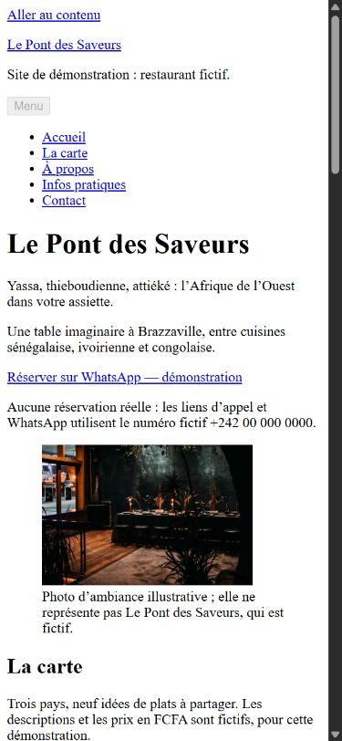

# Le Pont des Saveurs

Site vitrine de démonstration pour un **restaurant fictif à Brazzaville**, réalisé par Adriano Bosso, étudiant en Systèmes d’Information et Génie Logiciel.

Site publié sur GitHub Pages : https://bossozephyrin-star.github.io/le-pont-des-saveurs/

## Pourquoi ce projet ?

Présenter dans un portfolio une base de site de restaurant claire, accessible et légère, réunissant les cuisines du Sénégal, de Côte d’Ivoire et du Congo. Aucun avis, récompense, chiffre commercial ou établissement réel n’est revendiqué.

## État actuel : HTML uniquement

À la demande d’Adriano, **le CSS viendra plus tard**. Il n’y a ni feuille de style, ni style inline, ni JavaScript interactif. Le seul script est un bloc de données JSON-LD non exécutable. Le navigateur utilise son affichage natif.

- Cinq sections, un seul `main`, un seul `h1`, puis des titres hiérarchisés.
- Lien d’évitement, ancres, listes de plats, coordonnées dans `address` et horaires dans `table` avec `caption` et en-têtes `scope`.
- Neuf plats, trois par pays, avec descriptions et prix fictifs en FCFA.
- Navigation toujours visible ; bouton du futur menu mobile désactivé. Après le CSS, `script.js` sera chargé avec `defer` et gérera ouverture, fermeture, Échap et clic sur un lien.
- Métadonnées, canonical, Open Graph et JSON-LD `Restaurant` correspondant au contenu visible et signalant la démonstration.
- Coordonnées, horaires et numéro **fictifs**. Les liens `tel:` et `wa.me` illustrent leur syntaxe ; ne pas les utiliser pour contacter quelqu’un.
- Carte Google Maps du quartier du Plateau, récupérée via « Partager / Intégrer une carte », avec titre, chargement différé et mention d’emplacement indicatif. Ce n’est pas la position d’un restaurant réel.

## Choix de structure

Les plats sont des **listes `ul`**, car ils constituent des éléments d’une même carte, pas des articles autonomes. Un lecteur d’écran peut annoncer le nombre d’éléments. Les pays portent un `h3` et les plats un `h4`, sans saut de niveau.

## Images et crédits

Photo d’ambiance de **Rachel Claire**, [Pexels, photo 4577715](https://www.pexels.com/photo/interior-of-restaurant-with-served-table-4577715/), utilisée selon la [licence Pexels](https://www.pexels.com/license/). Elle est explicitement illustrative et ne représente pas le restaurant fictif. Aucune photo de plat n’a été retenue faute de correspondance fiable trouvée sur Pexels.

| Fichier | Dimensions du fichier | Taille |
| --- | --- | --- |
| `assets/ambiance.webp` | 1200 × 800 | 68 570 octets |
| `assets/og-image.webp` | 1200 × 630 | 52 588 octets |

Recadrage et conversion WebP à qualité 75 avec Pillow/libwebp : **Squoosh était inaccessible** lors de la réalisation. La photo d’accueil ne charge pas en lazy. Ses attributs HTML `width="240" height="160"` conservent le rapport 3:2 et un affichage compact sans CSS ; le futur CSS pourra l’agrandir de façon responsive. L’image Open Graph n’est pas téléchargée par la page elle-même.

Favicon SVG original représentant un pont. Aucun service d’image distant n’est appelé au chargement de la photo.

## Polices

Une famille préparée : **Lora**, latin, graisses 400 et 700 en WOFF2, téléchargée via [google-webfonts-helper](https://gwfh.mranftl.com/fonts/lora?subsets=latin). Licence dans `fonts/OFL-Lora.txt`. La graisse 400 est préchargée ; les déclarations `@font-face` avec `font-display: swap` seront ajoutées à l’étape CSS. Le navigateur peut donc signaler pour l’instant un preload inutilisé : c’est une conséquence de cette étape intermédiaire.

## Lancer localement

Aucune compilation ni dépendance applicative. Ouvrir `index.html`, ou, avec Python installé, lancer depuis le dépôt :

```sh
python -m http.server 8000
```

Puis ouvrir http://localhost:8000/ et arrêter le serveur avec Ctrl+C.

## Déploiement

GitHub Pages : Settings → Pages → Deploy from a branch → `main` → `/ (root)`.
Tous les chemins de ressources locales sont relatifs sans slash initial. Les URL canonical, Open Graph et JSON-LD sont absolues pour décrire correctement la page publique.

## Vérifications et suite

Consulter [le rapport de vérification](docs/verification.md) pour les résultats réellement obtenus. Les scores Lighthouse définitifs et le test sur téléphone réel seront à reprendre après le CSS et le JavaScript. L’objectif 90/100 dans les quatre catégories n’est **pas un score acquis**.

L’étude de cas de cette étape se trouve dans [docs/etude-de-cas.md](docs/etude-de-cas.md).

Capture intermédiaire dans une fenêtre de 390 × 844 pixels, sans CSS (ce n’est pas un test sur téléphone physique) :


